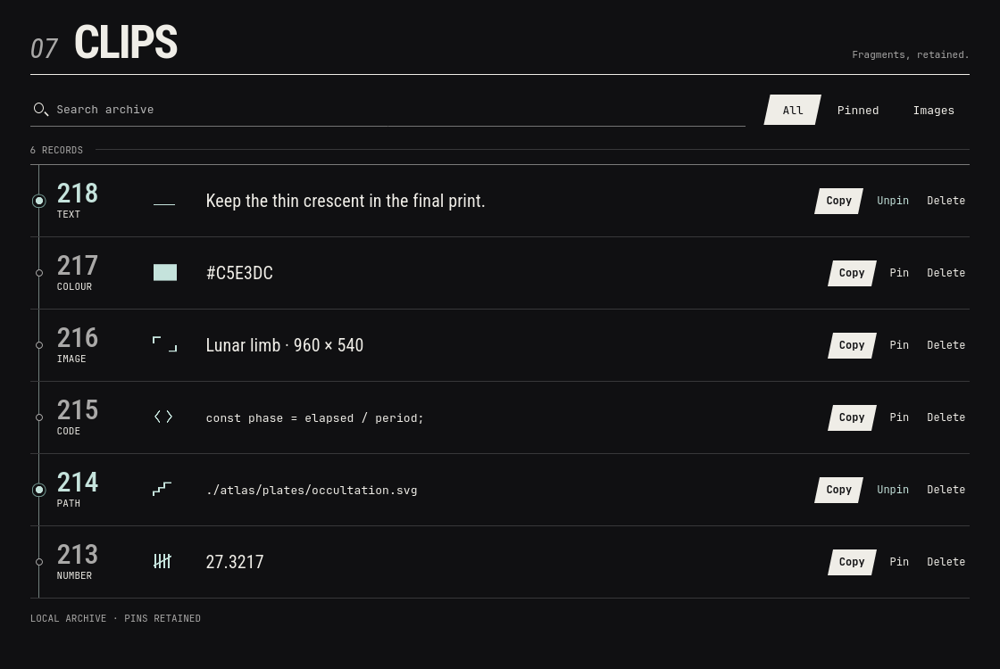
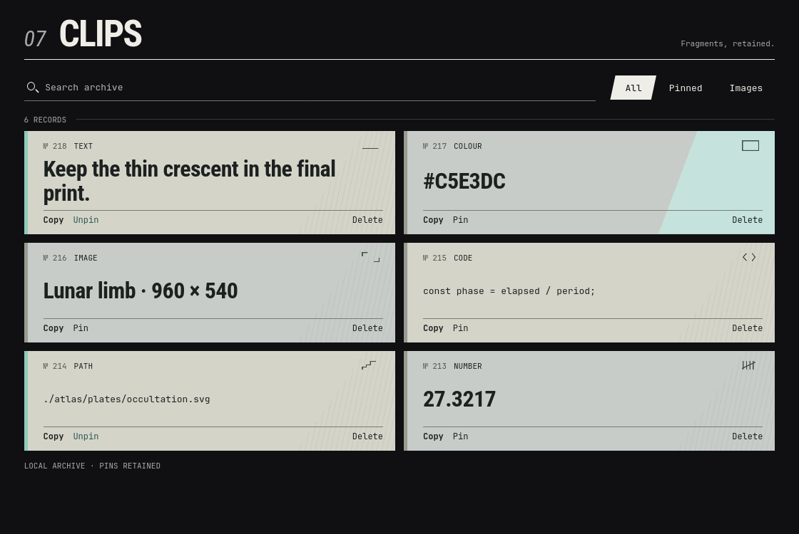

# Clips room · visual choice

Open `index.html` directly. Both layouts use the same six invented records. Search, filters and entry actions work against the sample in memory. Copy shows the room’s acknowledgement. Reset sample restores the original entries. The Pinned filter includes a saved-only example from the fallback pin store.

| A · Transit log | B · Contact sheet |
| --- | --- |
|  |  |
| Follow the line down the left. Each stop is a record. A ring marks a pin. Excerpts have the width of the room, with Copy in one column. | Each record has a pale plate. A large excerpt and a mark for its kind help you recognise it. A colour sample fills the corner of its plate. |

Both studies reuse the Clips room’s search, record IDs, kind marks and action vocabulary. Image records show their description. The header stands in for the shell’s existing room band. A native implementation should keep the current history lease, 100-record paging, saved-pin handling and Overdrive effect. Quick paste has its own island face.

The PNGs show the All filter at 1120 × 750. Open `index.html?look=rail&frame` or `index.html?look=plates&frame` in a browser to see only the room.
