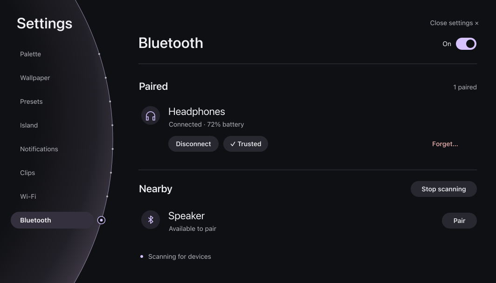
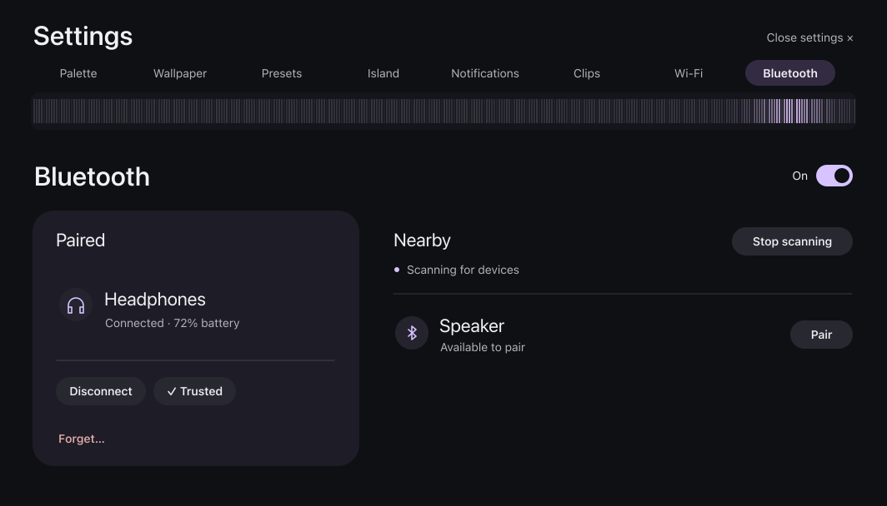
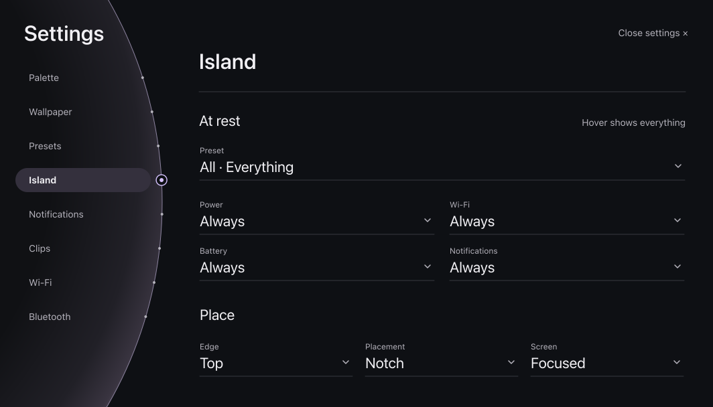
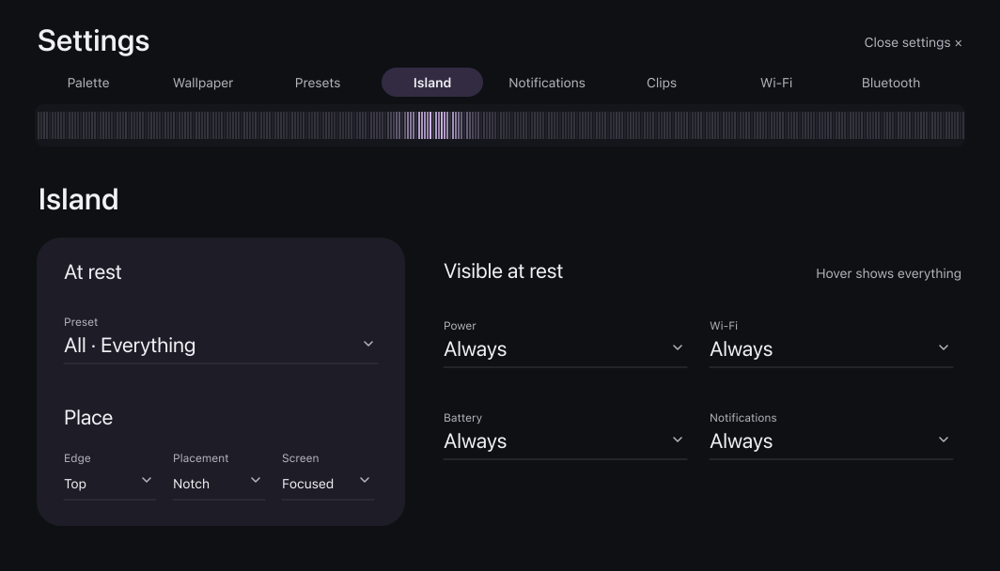

# Fluid Settings

**Owner pick, 21 November 2026 · A · Limb.** The native implementation is on `codex/fluid-limb`. Both studies show the same synthetic Bluetooth state and Island preferences. The eight section names follow their native order. Text uses Fluid’s Inter type scale. Lavender illustrates the palette accent.

| A · Limb | B · Spectrum |
| --- | --- |
|  |  |
|  |  |
| Choose a section down the edge of a planet. The active section has a ring on the rim. The rest of the width belongs to the settings. | Choose a section across the top. A narrow band of light follows the active tab. Paired devices sit beside discovery results, and the Island preset sits beside its individual choices. |

The examples show scanning in progress, a connected and trusted audio device, and one nearby device. The Island page shows the Everything preset at the top edge of the focused screen. The diagrams depict the resting appearance of these controls.

Open any PNG directly. Run `python3 tools/fluid-settings-study/render.py` to reproduce the four 1064 × 608 mockups using the installed `rsvg-convert`. The drawings and fixture copy originate here.
