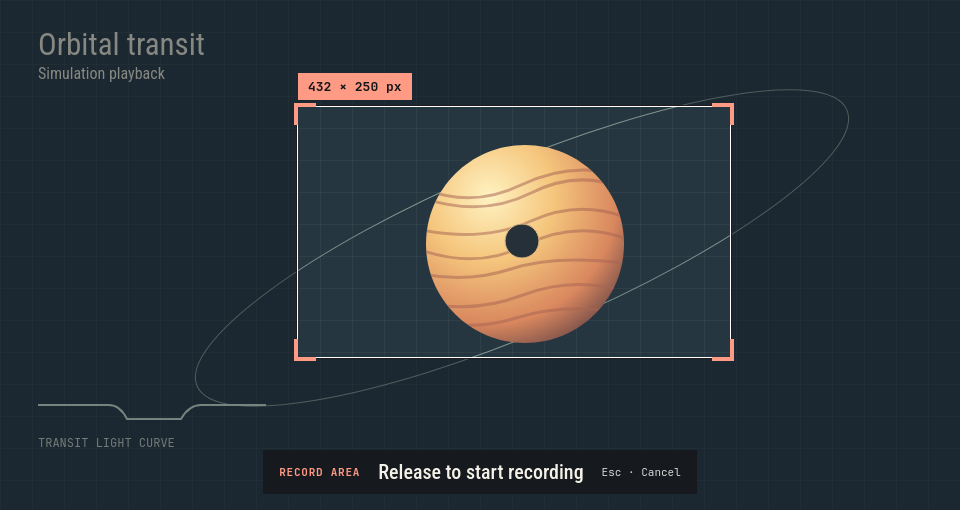
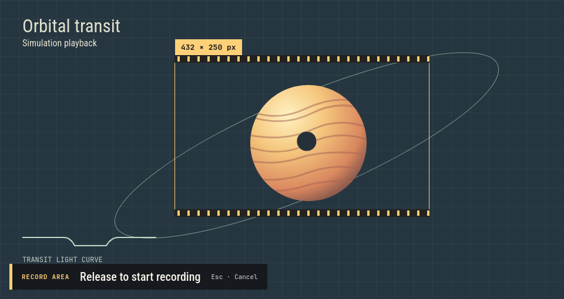

# Recording area · two live picker studies

Open `index.html` and drag across the moving orbit. The sample runs entirely in the page. Release completes the example, Escape or a right click cancels, and Reset sample restores the initial hint. The orbit respects reduced motion.

| A · Viewfinder | B · Splice |
| --- | --- |
|  |  |
| Four coral corners enclose the area. The surroundings darken during the drag, and the centre stays live. | Amber film perforations run just outside the top and bottom of the area. The rest of the desktop stays at its original brightness. |

Both begin with “Drag an area to record”. During the drag they say “Release to start recording”, matching the core's region path. The hint moves clear of the chosen area or hides when space runs out. The size tab sits outside the area. The before-drag images are [Viewfinder](viewfinder-idle.png) and [Splice](splice-idle.png).

For native wiring, use a transparent overlay over the live desktop. The moving orbit is only the study background. Use the recorder's selected dimensions for the label and dismiss the overlay before the recorder starts. The core owns the recording, sound, mic and cancellation. A recording indicator belongs to the active recording state.

To reproduce the stills, open `index.html?look=viewfinder&frame&state=drag` or `index.html?look=splice&frame&state=idle` in a 960 × 510 offscreen browser. Frame mode fixes the synthetic animation at one instant.
