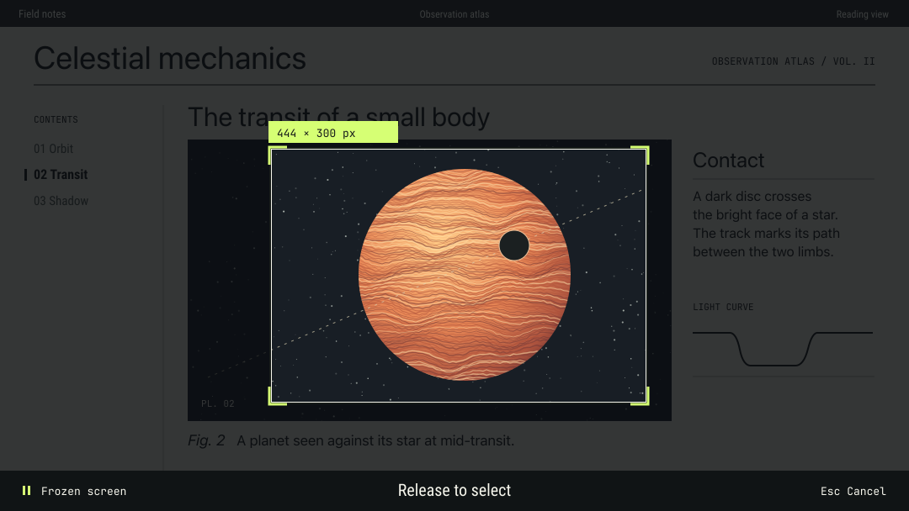

# Frozen-screen selector

**Owner pick, 21 November 2026 · A · Eclipse.** Claude A wires Eclipse into the frozen-grab selector under Z48 and Z221. Match the 79% blue-black shade outside the crop, thin pale edge, four lime corners and lime size label. The dark footer carries the instruction and Escape hint.

Compare the same drag across an invented atlas page. In each image, the selected 444 × 300 pixels keep their source colour and brightness.

| A · Eclipse | B · Transit | C · Proof |
| --- | --- | --- |
|  |  |  |
| The page goes dark. Four bright corners mark the crop. | The page stays readable. Sight along the extended edges to line up the crop. | The page fades to paper. A dark film frame holds the crop. |

The plain instruction before a drag is “Drag to select”. During a drag it changes to “Release to select”. Escape is visible in both states. Keep the size in source pixels. At a screen edge, move the size label to the opposite outside edge. If the crop fills the screen, clear the labels and frame so its contents stay visible.

The checked-in PNGs open directly. To redraw them, run `python3 tools/selector-study/render.py` with librsvg’s `rsvg-convert` available. All artwork and sample text originate in that script.
